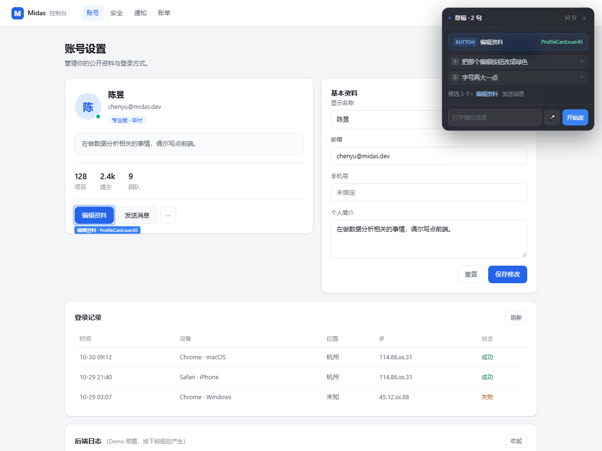

# ait · 点睛

在页面上画个圈，说一句话，改动落到源码上。

面向**手里有源码、以开发模式运行项目**的人。不内置模型，复用你已经在用的编码 Agent（Trae / WorkBuddy / Cursor / Claude Code）。

> 当前进度：画圈能命中、能输出准确的 `文件:行:列`、能与本地桥配对、投递任务并带上同一次请求的日志。
> 端侧语音（M3）与真实补丁落地（M5）尚未接入，见[状态](#状态)。



## 问题

改一处界面，成本不在改，而在到达：找到那个元素、说清改哪、把上下文搬进对话、再回来确认。

传统路径是"审查元素 → 抄 selector → 切到编辑器 → 打字描述 → 粘贴 → 回来刷新"。六步，每一步都要离开视线。

点睛把这条路径压缩成两个动作：**用鼠标指，用嘴说。**

## 它由三层组成

| 层 | 作用 | 不做什么 |
|---|---|---|
| **Chrome 扩展** | 画圈、命中、浮窗、端侧语音（待做） | 不读源码、不执行命令 |
| **本地桥** `npx ait` | 装配 dev server、DOM→源码映射、通道、校验落地 | 不做 UI、不内置模型 |
| **你的前端工程** | 被修改的对象 | — |

本地桥之所以必须是进程而不是扩展的一部分：读源码、跑 `tsc`、建 git 快照、当 MCP server，这四件事扩展做不到。

## 快速开始

```bash
pnpm install
pnpm ait          # 起本地桥 + dev server，终端会打印配对信息
```

然后：

1. Chrome 打开 `chrome://extensions`，开启开发者模式
2. 「加载已解压的扩展程序」→ 选 `packages/extension`
3. 点扩展的「详情 → 扩展程序选项」，把终端打印的 **Token** 填进去，点「测试连接」
4. 打开终端打印的页面地址，右上角出现蓝色「点睛」圆钮即成功

画个圈，说一句话（当前是打字模拟），说「开始改」——浮窗会显示桥的回执，终端会显示任务已落盘。

Chrome 137 正式版起禁止 `--load-extension`，扩展只能手动加载。

## 一条链路

画圈 → 说一句 → 命中元素与源码位置 → 浮窗成稿 → 任务提交到本地桥 → 回执

- **画圈不触发页面行为**：捕获阶段接管鼠标事件并 `preventDefault`，不产生 `click`
- **命中靠采样**：包围盒打 8×8 网格，`elementsFromPoint` 计票，贴合实际形状
- **源码位置靠编译期注入**：不猜组件名，插件在 dev 阶段把 `文件:行:列` 写进 `data-ait`，build 不注入
- **连接必须由 service worker 持有**：content script 的 WebSocket 带的是页面 Origin，会被桥按设计拒绝

## 目录

```
packages/
  vite-plugin/      @ait/vite-plugin  编译期注入 data-ait
  ait-bridge/       @ait/bridge       本地桥与 CLI
  extension/        Chrome 扩展（未打包，手动加载）
examples/
  vite-vue/         验证工程：Vite + Vue 3 + mock 后端（带 trace_id 日志）
scripts/            端到端验证脚本（CDP 驱动，需按本机路径调整）
demo/               初版验证页（纯静态 + 独立扩展，不依赖构建，可直接打开）
docs/               设计与架构定稿
```

## 状态

| 里程碑 | 内容 | 状态 |
|---|---|---|
| **M1** | 扩展骨架 + 浮窗四态 + 画圈 + `npx ait` 装配 | 完成 |
| **M2** | `data-ait` 编译期注入 + 语义匹配 | 完成 |
| **M3** | sherpa-onnx：KWS 唤醒 + VAD + 流式 ASR + 热词 | 未开始 |
| **M4** | 草稿编号 + 自然语言命令 + 提交词 | 完成 |
| **M5** | 通道适配（ACP / MCP）+ PatchGate + HMR 验证 | 部分：任务已能投递，补丁未落地 |
| **M6** | 日志关联 + trace id | 部分：扩展从页面日志镜像取 trace，桥按 trace 捞日志并写进任务；尚未做请求级注入与拦截 |

已验证（CDP 驱动真实扩展加载）：

| 项 | 结果 |
|---|---|
| `data-ait` 注入 | 示例工程 47 个元素，行列与源码一致，build 零注入 |
| 画圈命中 | 圈住「编辑资料」锁定，显示 `ProfileCard.vue:22` |
| 语义匹配 | 3 个候选中说「编辑」锁定编辑按钮 |
| 画圈无副作用 | 起笔在按钮内、外均不产生 `click`，危险按钮不会被误触 |
| 草稿编辑 | 三句累积、`第二条不要` 删对、`不要了` 清空 |
| 桥接鉴权 | 网页来源拒 4001、错误 token 拒 4003、正确配对通过 |
| 任务投递 | 浮窗显示桥回执「已收到，目标 ProfileCard.vue:22」 |
| 日志关联 | 任务落盘带 3 个 trace 与对应日志，`trace_id` 一一对得上 |
| 扩展 ID 固定 | `manifest.key` 生效，ID 稳定为 `eaaiilhdhnonbemdpmgepflpjniladdm` |

未实现且不打算在本仓库隐瞒：

| 缺口 | 归属 |
|---|---|
| 端侧语音（sherpa-onnx：VAD / 唤醒词 / 流式识别） | M3 |
| 真实改写：解析 patch、`tsc --noEmit` 校验、git 快照回滚 | M5 |
| MCP server / ACP 投递 | M5 |
| 扩展注入 trace id 并拦截请求（当前靠页面自己把日志镜像进 DOM） | M6 |

## 文档

- [产品设计定稿](docs/AIT-产品设计定稿.md) — 设计理念、交互流程、浮窗形态、取舍
- [架构定稿](docs/AIT-架构定稿.md) — 三层分工、核心能力、语音栈、协议、里程碑

## License

[MIT](LICENSE)
